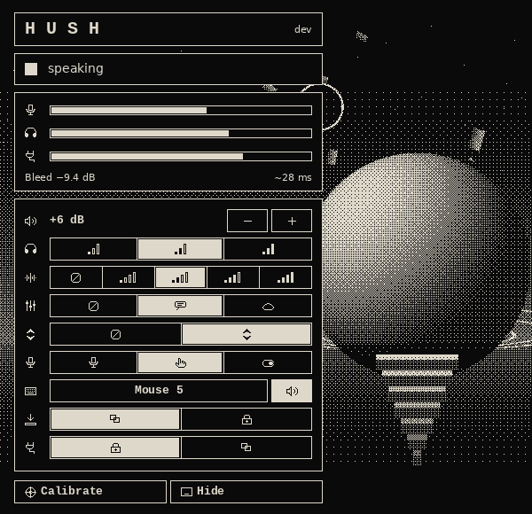

# hush

**English** · [Русский](#russian)

Removes headphone bleed from a headset microphone on Windows. Whatever plays in your headphones leaks into the mic, and the people you talk to hear themselves. hush measures that leak once, subtracts it in real time and passes the clean voice to a virtual cable that Discord, OBS or any other program uses as the microphone.

## Quick start

1. Install the free [VB-Cable](https://vb-audio.com/Cable/) driver (run `VBCABLE_Setup_x64.exe` as administrator and click **Install Driver**).
2. Download `hush.exe` from [Releases](../../releases/latest) and run it. No installation is needed.
3. Stay quiet for about 7 seconds while hush plays a short noise into your headphones. This is the one-time calibration.
4. In Discord (or any other program) choose **CABLE Output** as the microphone.

hush lives in the tray. Left click opens the panel, right click opens the menu.

## How it works

1. **Capture.** hush reads the microphone and, in parallel, the sound that goes to your headphones (WASAPI loopback). Both streams are aligned on a common timeline.
2. **Learning.** hush learns how strongly and with what delay your headphones leak into the mic from whatever plays in them while you are silent, and keeps re-learning every few seconds. It works for any headset without tuning: a wrong or outdated model is replaced automatically. The short noise burst on first launch only gives a head start.
3. **Suppression.** The leak is removed per frequency band by its envelope, so it works even when the bleed is not an exact copy of the headphone signal. Your own voice is detected and suppression softens while you speak.
4. **Output.** The cleaned signal is written to the virtual cable. In exclusive mode the cable output bypasses the Windows mixer, so screen sharing does not pick up your voice twice.

Also included: noise reduction (4 levels), a voice equalizer, auto gain with a limiter, push-to-talk or toggle on any key or mouse button with an optional sound cue, low-latency and exclusive mic capture, automatic reconnection after device loss or sleep, and putting the PC to sleep after a long silence (open audio streams otherwise keep Windows awake).

The interface is available in English and Russian and follows the Windows language.

## Data and startup

Settings, calibration and the log (`hush-config.json`, `hush-calib.json`, `hush-log.txt`) are stored next to `hush.exe`. If that folder is read-only, `%LOCALAPPDATA%\hush` is used instead. Settings from the previous name of the program (`micaec-*`) are picked up automatically.

hush checks GitHub Releases once an hour. When a new version is out, an **update** button appears next to the version on the panel and in the tray menu: the new `hush.exe` is downloaded, verified against `SHA256SUMS`, swapped in place and restarted.

On first launch hush enables **Start with Windows** for the current user (no administrator rights needed). It can be turned off in the tray menu. Closing the panel keeps hush in the tray; **Quit** stops it.

## Command line

| Flag | Description |
|---|---|
| `-list` | list audio devices |
| `-mic`, `-ref`, `-out` | part of a device name for the mic, headphones and output |
| `-recal` | calibrate again on start |
| `-doctor` | find where an echo comes from |
| `-record N` | record N seconds of mic and headphones to `hush-rec.zip` |
| `-console` | show a console with live levels |
| `-version` | print the version |

Run `hush.exe -h` for the full list.

## Building from source

Requires Go 1.24+. Run `./build.sh`: vet, tests with the race detector, then `dist/hush.exe`. The signal processing lives in `internal/` and is tested on any OS; the Windows part is in `cmd/hush`. Releases are built by GitHub Actions on every `v*` tag. Details are in [docs/DEVELOPMENT.md](docs/DEVELOPMENT.md).

## License

MIT. Third-party code: [THIRD_PARTY_NOTICES.md](THIRD_PARTY_NOTICES.md). VB-Cable is a separate product by VB-Audio and is not bundled. Provided as is, without warranty.

---

# hush

[English](#english) · **Русский**

Убирает из микрофона гарнитуры наводку от наушников в Windows. Всё, что играет в наушниках, просачивается в микрофон, и собеседники слышат сами себя. hush один раз измеряет эту наводку, вычитает её на лету и отдаёт чистый голос в виртуальный кабель, который Discord, OBS или любая другая программа берёт как микрофон.

## Быстрый старт

1. Установите бесплатный драйвер [VB-Cable](https://vb-audio.com/Cable/): запустите `VBCABLE_Setup_x64.exe` от имени администратора и нажмите **Install Driver**.
2. Скачайте `hush.exe` из [Releases](../../releases/latest) и запустите. Установка не нужна.
3. Помолчите около 7 секунд, пока hush проигрывает короткий шум в наушники. Это калибровка, она нужна один раз.
4. В Discord (или другой программе) выберите микрофоном **CABLE Output**.

hush работает из трея. Левый клик открывает панель, правый клик открывает меню.

## Как это работает

1. **Захват.** hush читает микрофон и параллельно звук, который идёт в наушники (WASAPI loopback). Оба потока выравниваются на общей шкале времени.
2. **Обучение.** hush сам выясняет, насколько сильно и с какой задержкой наушники попадают в микрофон, по тому, что в них играет, пока вы молчите, и переучивается каждые несколько секунд. Это работает с любой гарнитурой без настройки: неверная или устаревшая модель заменяется автоматически. Короткий шум при первом запуске нужен только для быстрого старта.
3. **Подавление.** Наводка убирается по полосам частот по огибающей, поэтому работает и тогда, когда она не точная копия звука наушников. Собственный голос распознаётся, и пока вы говорите, подавление мягче.
4. **Вывод.** Очищенный звук пишется в виртуальный кабель. В монопольном режиме вывод минует микшер Windows, и демонстрация экрана не захватывает ваш голос второй раз.

Также есть: шумоподавление (4 уровня), эквалайзер голоса, автогромкость с ограничителем, микрофон по кнопке (удержание или переключение, любая клавиша или кнопка мыши) со звуковым сигналом, захват микрофона с малой задержкой и монопольно, автоматическое переподключение после потери устройства или сна, перевод ПК в сон после долгой тишины (открытые аудиопотоки иначе не дают Windows уснуть).

Интерфейс доступен на русском и английском, язык берётся из Windows.

## Данные и автозапуск

Настройки, калибровка и журнал (`hush-config.json`, `hush-calib.json`, `hush-log.txt`) хранятся рядом с `hush.exe`. Если в эту папку нельзя писать, используется `%LOCALAPPDATA%\hush`. Настройки прежней версии программы (`micaec-*`) подхватываются автоматически.

Раз в час hush проверяет релизы на GitHub. Когда выходит новая версия, на панели рядом с номером версии и в меню трея появляется кнопка **обновить**: новый `hush.exe` скачивается, сверяется с `SHA256SUMS`, подменяет текущий и перезапускается.

При первом запуске hush включает **Запуск вместе с Windows** для текущего пользователя (права администратора не нужны). Выключается в меню трея. Закрытая панель оставляет hush в трее; **Выход** завершает работу.

## Командная строка

| Ключ | Описание |
|---|---|
| `-list` | показать звуковые устройства |
| `-mic`, `-ref`, `-out` | часть названия микрофона, наушников и вывода |
| `-recal` | заново откалибровать при запуске |
| `-doctor` | найти, откуда берётся эхо |
| `-record N` | записать N секунд микрофона и наушников в `hush-rec.zip` |
| `-console` | показать консоль с уровнями |
| `-version` | показать версию |

Полный список: `hush.exe -h`.

## Сборка из исходников

Нужен Go 1.24+. Команда `./build.sh`: vet, тесты с детектором гонок, затем `dist/hush.exe`. Обработка звука лежит в `internal/` и тестируется на любой ОС; часть для Windows — в `cmd/hush`. Релизы собирает GitHub Actions на каждый тег `v*`. Подробности — в [docs/DEVELOPMENT.md](docs/DEVELOPMENT.md).

## Лицензия

MIT. Сторонний код: [THIRD_PARTY_NOTICES.md](THIRD_PARTY_NOTICES.md). VB-Cable — отдельный продукт VB-Audio, в комплект не входит. Предоставляется «как есть», без гарантий.
